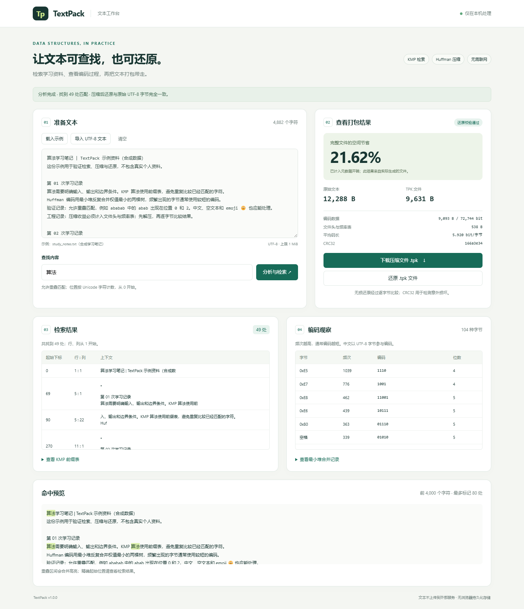
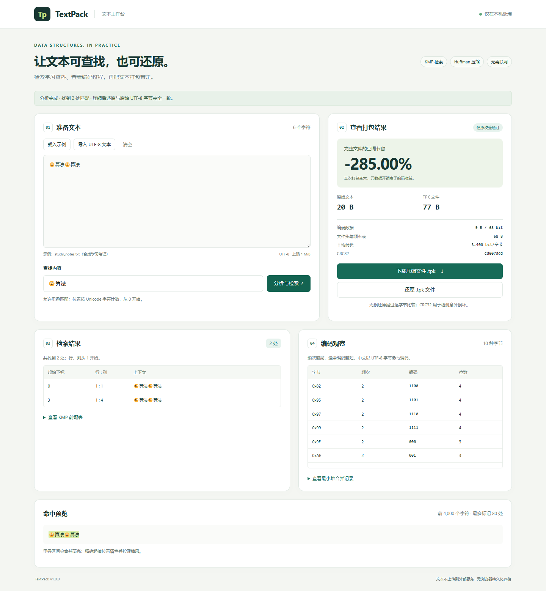

# TextPack

**基于 KMP 检索与 Huffman 编码的本地学习资料工具。**

将 UTF-8 笔记导入工作台，查找所有匹配位置，查看字节编码与真实压缩收益，下载 `.tpk` 文件并校验还原。项目包含浏览器界面和命令行接口；核心逻辑不依赖外部服务。

版本：`v1.0.0`。课程提交的姓名、学号、院系和最终 Git 版本放在随附的提交主文档中。此目录提供可直接运行的项目版本。



## 1. 背景、目标与验收

本项目以整理课程笔记这一典型学习场景为需求假设：使用者需要找出术语的全部出现位置，判断一份文本是否值得压缩，并能确认还原结果没有改变。普通查找功能较少解释匹配下标；直接观察压缩码流长度又容易忽略元数据开销。

本次完成以下流程，未声称已经开展真实用户调研：

| 目标 | 已完成的行为 | 验收方式 |
| --- | --- | --- |
| 完整检索 | 返回所有位置，允许重叠，展示行列与上下文 | 与朴素匹配逐例对照 |
| 无损打包 | 自行实现字节 Huffman 编码、位打包与解码 | 字节级往返比较、已知编码样例 |
| 结果可解释 | 显示前缀表、编码表、堆合并记录及完整文件大小 | 与实际生成的文件核对 |
| 错误可识别 | 拒绝截断、无效头、异常频率、补齐位和校验错误 | 反例测试及界面错误提示 |
| 可复现 | 示例文件、预期输出、测试和运行说明齐全 | 新目录复制运行与命令行演示 |

## 2. 安装与运行

运行要求：**Python 3.10 或更新版本**；标准库即可，`requirements.txt` 中没有第三方运行依赖。实测环境为 Windows 11、Python 3.12.14、Edge 155.0.4283.62。其他系统与 Python 版本未在本机实测；仓库提供了 Python 3.10/3.12 的 CI 配置，不能据此声称远端 CI 已通过。

在项目根目录执行：

```sh
python main.py serve
```

浏览器打开 `http://127.0.0.1:8765`。按 Ctrl+C 停止服务。若端口被占用：

```sh
python main.py serve --port 8877
```

网页必须通过上述本地服务访问，不能直接双击 HTML。服务器只监听本机地址，界面文本不上传到外部服务，也不写入浏览器持久化存储。

### 命令行示例

```sh
python main.py search examples/overlap.txt abab
python main.py analyze examples/study_notes.txt --pattern 算法
python main.py compress examples/study_notes.txt notes.tpk
python main.py decompress notes.tpk restored.txt
```

第一条命令返回 `count: 2`、`positions: [0, 2]`。后两条命令形成完整的压缩和还原流程。默认不覆盖已有输出文件；确认需要覆盖时加 `--force`，输入输出为同一路径时仍拒绝执行。

查看 `examples/expected_analysis.json` 可核对示例的完整分析结果。示例笔记为本项目生成的合成文本，来源与生成方式见 [数据与实验说明](docs/experiments.md)。

## 3. 功能约定与演示步骤

1. 点击“载入示例”，工作台自动分析示例笔记。预期找到“算法”49 处，原始大小 12,288 B，TPK 文件 9,631 B，节省 21.62%。
2. 把文本改成 `ababab`，查找 `abab`，应得到 `[0, 2]`；修改后旧下载按钮会失效，重新分析才可下载。
3. 把文本改成 `🙂算法🙂算法`，查找 `🙂算法`，应得到 `[0, 3]`。下标按 Unicode 码点计数，不是 UTF-8 字节或 JavaScript UTF-16 单元。
4. 下载 `.tpk` 后，通过“还原 .tpk 文件”导入，观察校验通过和文本恢复。
5. 导入任意非 TPK 文件，观察可读的错误提示。输入 `banana` 时，完整文件由 6 B 变为 35 B，界面如实显示负收益。



检索区分大小写，不自动做 Unicode 规范化。空模式串返回空列表。行列从 1 开始，下标从 0 开始；仅 LF 作为行分隔符，CRLF 中的 CR 仍参与原始下标计数。界面展示前 200 个命中，前缀表展示前 100 项；总命中数计算完整，命中预览只展示前 4,000 个字符并标记前 80 处。需要全部位置时使用 CLI `search`。

界面支持最多 1 MiB 的 UTF-8 文本、16 KiB 的模式串；核心/CLI 支持最多 8 MiB 的输入或还原结果。CLI 压缩与解压支持任意二进制文件；网页只展示 UTF-8 文本。导入内容的 BOM 和 CRLF 在未经文本编辑时保持不变；一旦手工编辑 textarea，浏览器会把换行规范化为 LF。再次下载对应的是编辑后的文本。

## 4. 课程知识与核心设计

### KMP：数组与字符串匹配

`src/textpack/kmp.py` 实现前缀函数 `pi`。当已匹配 j 个字符而下一字符不匹配时，令 `j=pi[j-1]`，不回退文本位置。完整匹配后也沿前缀函数回退，而非清零，所以能保留重叠匹配。

不变式：扫描文本到当前位置时，j 是已处理文本后缀与模式前缀的最长匹配长度。失配链只排除不可能继续的候选；达到模式长度才输出，因此不漏报、不误报。文本指针只前进，模式指针回退次数由此前增长摊还，总时间 **O(n+m)**；除结果外额外空间 **O(m)**。存放 r 个结果需要额外 O(r) 空间，行列呈现另做至多一次前向扫描。

### Huffman：计数表、最小堆与二叉树

`src/textpack/codec.py` 用 `Counter` 统计字节频次，用标准库 `heapq` 管理最小堆；选择哪两棵树、构建二叉树、生成码表、打包比特和还原遍历均在本项目实现。每轮取出两个最小权值，合并后放回，直到得到根。

叶结点对应字节，左边记 0、右边记 1，从根到叶的路径为码字。叶路径之间没有前缀关系，因此可以唯一解码。最优树中可通过交换把两个最小权值放在最深的兄弟叶上，收缩后得到相同结构的子问题；该贪心过程最小化给定字节频次下的前缀编码加权路径长度。**最优前缀码不等于最小容器，也不等于通用压缩最优。**

同频率时按子树中最小字节值排序，使压缩与解压无需依赖字典迭代顺序，就能重建相同树。当前堆中的子树互不相交，其最小字节值各不相同，元组比较不会落到不可比较的 Node 对象。

设 B 为原始字节数、σ 为不同字节数（≤256）、L 为有效编码位数：计数 O(B)，建树 O(σ log σ)，生成字符串码表最坏 O(σ²)，编码/解码 O(B+L)。码表和树空间 O(σ²)，当前内存实现还保存输入、输出与检索结果；不会把整个应用的空间误写成 O(σ)。固定字节字母表下，码表是受限的常量规模。

### TPK1 容器与校验

文件头 18 B，之后为 σ 项、每项 5 B 的字节频率表，再接按高位优先打包的码流。完整文件大小为 `18 + 5σ + ceil(L/8)`。空文件保留文件头；只有一个符号时约定编码为 `0`。

解压先验证大小上限、符号数量、表顺序与频率总和、有效位数和文件精确长度，再验证补齐位、码字结束位置、输出频率和 CRC32。CRC32 用于检测意外损坏，不能认证来源，也不是加密。详细格式和推导见 [设计说明](docs/design.md)。

## 5. 项目结构

```text
TextPack/
  main.py                  统一启动入口
  src/textpack/
    kmp.py                 Unicode 匹配与行列定位
    codec.py               Huffman 与 TPK1 容器
    service.py             共用业务流程
    cli.py                 命令行参数与文件读写
    server.py              本机 HTTP 适配层
  web/                     HTML / CSS / JavaScript 界面
  tests/                   单元、接口、浏览器测试及实验
  examples/                合成输入、预期结果与示例归档
  docs/                    设计、实验、协作声明与真实截图
  .github/workflows/       可选 CI 配置
```

## 6. 测试与实测结果

```sh
python -m unittest discover -s tests -v
python tests/run_checks.py
python tests/experiments.py
```

`run_checks.py` 会把本次结果写入 `docs/test-results.json` 和 `docs/test-output.txt`；`experiments.py` 生成 `docs/experiment-results.json`。报告保存实际时间和环境，不用预设的“通过”替代测试执行。

本次实测 **38/38 个测试方法通过**，包括 7,905 对短字符串与朴素算法的对照、255 个前缀函数定义对照、180 个固定种子随机字节往返、40 组与穷举合并代价的比较，以及 CLI、HTTP、Unicode、空输入和损坏数据测试。`tests/browser.mjs` 的 **13 项浏览器检查通过**，包含实际下载、CRLF/BOM 字节对比、还原、错误提示和 390 px 窄屏检查。

| 样例 | 原始大小 | TPK 完整大小 | 节省比例 | 实际还原 |
| --- | --- | --- | --- | --- |
| 空文件 | 0 B | 18 B | 不适用 | 一致 |
| `banana` | 6 B | 35 B | -483.33% | 一致 |
| 每种字节出现一次 | 256 B | 1,554 B | -507.03% | 一致 |
| 合成学习笔记 | 12,288 B | 9,631 B | 21.62% | 一致 |
| 固定种子随机字节 | 4,096 B | 5,384 B | -31.45% | 一致 |

搜索实验的文本为 n 个 `a`，模式为 63 个 `a` 加 `b`，用于构造大量重复前缀失配。n=16,000 时，KMP 实际执行 48,122 次字符比较，朴素算法执行 1,019,968 次；两者均无匹配。KMP 计数含前缀函数构造。固定模式长度的这张表只能显示比较次数及常数差异，不能单凭计时证明一般渐近复杂度。

浏览器测试属于可选开发依赖，日常运行不需要 Node.js：

```sh
npm install
npx playwright install chromium
npm run test:browser
```

需 Node.js 20+ 和 Playwright 1.62.1。脚本自动启动测试服务器，结束后关闭；默认调用 `python`，可用 `TEXT_PACK_PYTHON` 指定 Python 路径，也可用 `TEXT_PACK_BROWSER` 指定已安装的 Chromium/Edge 可执行文件。

## 7. 局限与改进

- 字节 Huffman 只利用单字节频率，不能利用整段重复；同一合成笔记的标准库 gzip 文件为 636 B，明显小于本项目的 9,631 B。本项目主要用于课程理解与可验证的资料处理，不替代成熟压缩工具。
- 自定义 `.tpk` 不能由 ZIP 工具打开，没有多文件归档、流式压缩、全文索引、正则表达式或加密功能。
- Python 逐位解码速度有限；当前将文件读入内存，因此设置大小上限。HTTP 服务只面向本机课堂演示，不作为公网服务部署。
- 非 UTF-8 文件请使用 CLI 二进制流程；图形组合字符按码点计数，不保证符合视觉上的“一个字”。
- 未来可增加规范 Huffman 码以缩小元数据、分块处理以控制内存、性能基准和有真实参与者的可用性测试；这些均未作为已完成功能。

## 8. 来源与 AI 使用声明

**使用工具：** OpenAI Codex。**参与环节：** 需求范围选择、架构、核心代码、界面、测试、调试、截图、实验与文档。核心代码允许由 AI 生成，本项目如实采用此方式。

**本人已提供的信息与判断：** 提供作业要求、姓名和学号，并明确确认采用 TextPack 选题。其余本轮实现、设计取舍和测试执行由 Codex 完成；目前没有可确认的学生本人独立编码、运行或审查记录，因此不将其写成已完成事实。学生需在提交前亲自运行并核查项目、理解关键算法；可使用 [演示与讲解提纲](docs/demo-guide.md) 准备，并根据真实复核情况补充本段。

**验证方法：** 独立朴素算法/穷举代价对照、字节往返、异常输入、CLI/HTTP 接口测试与真实浏览器操作。检查结果见 `docs/*-results.json`。**代表性协作案例：** [AI 协作记录](docs/ai-collaboration.md)，记录项目中实际发生的取舍与修复，不冒充学生对话或用户反馈。

**引用与复用范围：** KMP、Huffman 来自课程中的经典算法；代码为本次由 Codex 生成与修订，未复制教师项目、开源仓库业务代码、第三方图标或真实学习资料。复用标准库承担通用设施：

- [Python heapq 文档](https://docs.python.org/3/library/heapq.html)：最小堆的存储与入堆、出堆操作。
- [Python struct 文档](https://docs.python.org/3/library/struct.html)：固定宽度、大端二进制字段。
- [Python zlib 文档](https://docs.python.org/3/library/zlib.html)：TPK 只使用 CRC32；对照实验另调用标准库 gzip。
- [Python unittest 文档](https://docs.python.org/3/library/unittest.html)：测试组织与执行。
- Playwright 仅用于自动化操作界面和生成实际运行截图，不是产品运行依赖。
